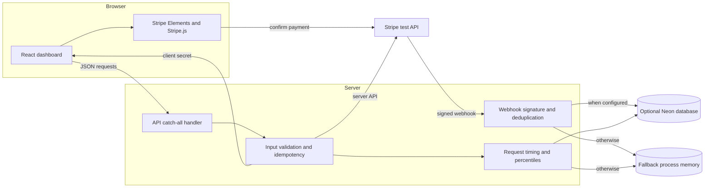
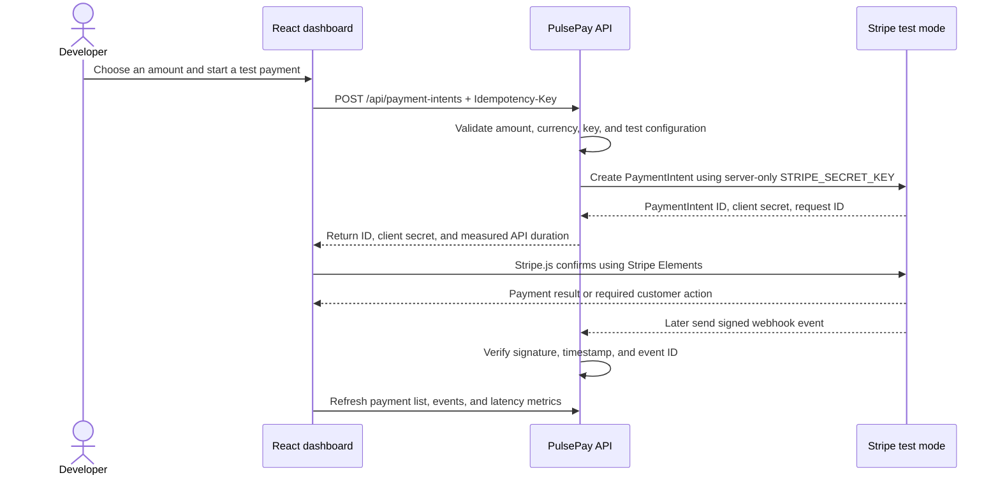

# PulsePay — Payment Reliability Desk

> A beginner-friendly payment integration workbench for exploring Stripe test payments, safe retry decisions, webhook delivery, and API latency.

**Live app:** [pulsepay-payment-performance-lab.vercel.app](https://pulsepay-payment-performance-lab.vercel.app/)  
**Source:** [github.com/rithika20252024/pulsepay-payment-performance-lab](https://github.com/rithika20252024/pulsepay-payment-performance-lab)

PulsePay is a small, useful payment operations app: it lets a developer create a Stripe **test-mode** PaymentIntent, confirm it through Stripe Elements, inspect its status, receive signed webhook events, and see how long the server's Stripe API requests took. A recovery guide explains what to do when a request times out, a card is declined, or a payment is still processing.

It is a learning and integration project. It does not accept real payments or replace a production payment platform. In demo mode, example payments and events are clearly labelled. API latency measurements come from actual requests made by this running app; the recovery lab's simulated timings are separate synthetic examples.

## Start here

If you are new to the code, read these sections in order:

1. [What happens during a test payment?](#what-happens-during-a-test-payment)
2. [Architecture](#architecture)
3. [Code map](#code-map)
4. [Run the project on your computer](#run-the-project-on-your-computer)
5. [API routes](#api-routes)

## What you can do

- **Create a test payment:** Create a Stripe PaymentIntent from the dashboard, then confirm it using Stripe Elements. The app handles payment details with Stripe.js; the app's server never receives card numbers or CVCs.
- **Inspect payment state:** See PaymentIntents returned by your Stripe test account, including status and available decline information.
- **Review webhook delivery:** Verify Stripe's signature, reject live-mode events, ignore duplicate event IDs, and inspect recent verified events.
- **Make safer recovery choices:** Read scenario-specific guidance for timeouts, network failures, rate limits, declines, authentication, invalid requests, and payments already processing.
- **Observe API latency:** See p50, p95, and p99 timing summaries for outbound Stripe API requests, with the sample count and measurement source.
- **Export measurements:** Download the displayed latency summary as CSV.

## Architecture

This diagram uses Mermaid, which GitHub renders directly in the README. It describes the running application rather than a separate design mock-up.



### Main pieces

| Piece | Responsibility | Main file |
| --- | --- | --- |
| Browser UI | Shows payments, webhook inbox, recovery advice, and latency measurements | `src/App.jsx` |
| Browser entry point | Mounts React and loads the stylesheet | `src/main.jsx` |
| Visual design | Responsive layout, panels, forms, badges, and smaller-screen behavior | `src/styles.css` |
| API | Validates requests, calls Stripe, verifies webhooks, and calculates metrics | `api/[...path].js` |
| Local web server | Serves the built UI and forwards API requests to the API handler | `server.js` |
| Local development proxy | Sends the browser's `/api` calls to the local API on port 3000 | `vite.config.js` |
| Database schema | Optional tables for payment metadata, events, and request timings | `db/schema.sql` |
| Vercel setup | Builds the frontend and deploys the serverless API | `vercel.json` |

## Tech stack

PulsePay uses a small JavaScript stack with separate browser and server responsibilities. The browser never needs the Stripe secret key; payment details are handled by Stripe.js, while the Node.js API uses the secret key for server-to-server requests.

| Layer | Technology | How PulsePay uses it |
| --- | --- | --- |
| Language | JavaScript (ES modules and Node.js) | UI behavior, local server, API routes, and payment/webhook logic. The codebase is JavaScript, not TypeScript. |
| UI markup | JSX | React component markup in `.jsx` files. Vite transforms JSX during development and build. |
| Frontend | React 18, React DOM | Renders the payment desk and manages its browser-side state. |
| Styling | CSS | Responsive dashboard styles in `src/styles.css`; no CSS framework is configured. |
| Frontend tooling | Vite 6, `@vitejs/plugin-react` | Local dev server, `/api` proxy, and production bundle generation. |
| Local process runner | `concurrently` | Starts the local Node API and Vite dev server together with `npm run dev`. |
| Payments | Stripe PaymentIntents API, Stripe.js, `@stripe/react-stripe-js` | Creates PaymentIntents on the server and confirms them in the browser with Stripe Elements, using test mode. |
| Icons | `lucide-react` | Supplies the dashboard's interface icons. |
| API runtime | Node.js built-in HTTP server locally; Vercel Node.js Function when deployed | Runs the shared API handler in `api/[...path].js`. The project does not use Express. |
| Optional database | Neon Postgres and `@neondatabase/serverless` | Persists payment metadata, verified event IDs, and request timing samples when `DATABASE_URL` is set. |
| Database language | SQL | Defines the optional tables and indexes in `db/schema.sql`. |
| Hosting | Vercel | Serves the built static frontend and routes `/api/*` to the Node.js Function. |

**At a glance:** React + JSX + CSS in the browser → same-origin JSON API → Stripe test mode. Neon Postgres is optional; without it, bounded in-process buffers are used and can reset when the serverless instance is recycled.

## What happens during a test payment?



The server creates a **PaymentIntent**, but creation alone does not mean the payment succeeded. The browser uses Stripe Elements to collect the test payment method and Stripe.js to confirm it. Stripe can then send an event to the webhook route. The UI refreshes its data after the confirmation flow.

When the server cannot tell whether a request reached Stripe—for example, because the connection timed out—the UI retains the same idempotency key for a retry. Reusing the key helps avoid creating a second intent for the same operation. A new payment attempt gets a new key.

## Code map

```text
.
├── api/
│   └── [...path].js   Vercel API handler: routes, Stripe calls, webhooks, metrics
├── db/
│   └── schema.sql     Optional Postgres tables and indexes
├── src/
│   ├── App.jsx        Dashboard UI and browser-side payment confirmation
│   ├── main.jsx       React application entry point
│   └── styles.css     Responsive styles
├── .env.example       Names and example formats for local configuration
├── index.html         HTML document used by Vite
├── server.js          Local Node server for API and built frontend
├── vite.config.js     Vite React setup and local /api proxy
├── vercel.json        Vercel build and serverless function configuration
└── package.json       Dependencies and development/build commands
```

### Where to look first

1. Open `src/App.jsx` to see the dashboard sections and how it calls `/api/...` routes.
2. Open `api/[...path].js` to follow how those routes validate inputs and call Stripe.
3. Search in that API file for `configuration()` to see how demo mode and test mode are selected.
4. Search for `stripeRequest()` to see how outbound Stripe requests and their durations are handled.
5. Search for `verifySignature()` and the `webhooks/stripe` route to learn how Stripe events are checked.
6. Open `db/schema.sql` to see the metadata retained when Neon is configured.

The Vercel API file is a catch-all handler: it reads the URL after `/api/` and dispatches to the matching route. The local server imports that same handler, so local development and Vercel use the same API behavior.

## Run the project on your computer

### Requirements

- Node.js 20 or newer
- npm
- Stripe test-mode API keys to create real test PaymentIntents (the dashboard and recovery guide also run without them)

### Install and run

```bash
git clone https://github.com/rithika20252024/pulsepay-payment-performance-lab.git
cd pulsepay-payment-performance-lab
npm install
npm run dev
```

Vite serves the dashboard at [http://localhost:5173](http://localhost:5173). The local Node API listens on port `3000`; Vite proxies browser requests beginning with `/api` to it.

To run the app with Stripe test mode, set the variables **before** starting `npm run dev`. For macOS or Linux shells:

```bash
export STRIPE_SECRET_KEY='sk_test_...'
export STRIPE_PUBLISHABLE_KEY='pk_test_...'
npm run dev
```

For PowerShell:

```powershell
$env:STRIPE_SECRET_KEY = 'sk_test_...'
$env:STRIPE_PUBLISHABLE_KEY = 'pk_test_...'
npm run dev
```

The server reads environment variables from its process. `.env.example` documents the variable names but is not loaded automatically. Do not put a secret key in frontend code, a `VITE_` variable, or a committed file. `.env` and `.env.local` are ignored by Git; if you use a local environment-file loader, install and configure it intentionally.

Without valid test keys the dashboard stays in demo mode, the payment action is disabled, and its sample payments are labelled. It does not pretend that a sample payment succeeded in Stripe.

To build and serve the production bundle locally:

```bash
npm run build
npm start
```

The built dashboard is served at [http://localhost:3000](http://localhost:3000).

## Configure Stripe test mode

1. In the Stripe Dashboard, select **test mode** and open **Developers → API keys**.
2. Copy the test publishable key (`pk_test_...`) and reveal the test secret key (`sk_test_...`). The secret key must stay on the server.
3. Set them as `STRIPE_PUBLISHABLE_KEY` and `STRIPE_SECRET_KEY` in your local environment or Vercel project settings.
4. Restart the local server or create a new Vercel deployment after changing environment variables.
5. Open the dashboard and confirm the status says **Stripe test mode**.
6. Create a test payment and use a Stripe test payment method/card from Stripe's [testing guide](https://docs.stripe.com/testing). Do not enter real card details.

### Set up webhooks

Webhooks are separate from API keys. Stripe creates a signing secret (`whsec_...`) for each webhook endpoint.

**For local development**, install and authenticate the Stripe CLI, then forward events to the local API:

```bash
stripe listen --forward-to localhost:3000/api/webhooks/stripe
```

The CLI prints a webhook signing secret for that listener. Set it as `STRIPE_WEBHOOK_SECRET` in the local API process and restart the server. The CLI listener secret is for local forwarding; it is different from a deployed endpoint's secret.

**For the deployed app**, create a webhook endpoint in Stripe's test-mode Developers/Webhooks dashboard with this URL:

```text
https://pulsepay-payment-performance-lab.vercel.app/api/webhooks/stripe
```

Subscribe to the PaymentIntent events you want to inspect, copy the signing secret for that endpoint, and save it in Vercel as `STRIPE_WEBHOOK_SECRET` for Production. Redeploy so the function receives the new value. See [Stripe's webhook documentation](https://docs.stripe.com/webhooks) for endpoint setup and event delivery details.

## Environment variables

| Variable | Required? | Purpose |
| --- | --- | --- |
| `STRIPE_SECRET_KEY` | For Stripe API calls | Server-only test key used to create and retrieve PaymentIntents. Must start with `sk_test_`. |
| `STRIPE_PUBLISHABLE_KEY` | For browser payment confirmation | Test key used by Stripe.js. Must start with `pk_test_`. |
| `STRIPE_WEBHOOK_SECRET` | For signed webhook verification | Endpoint-specific signing secret starting with `whsec_`. Not an API key. |
| `DATABASE_URL` | Optional | Neon Postgres connection string for durable payment metadata, event IDs, and metrics. |
| `PORT` | Optional locally | Local API and static server port; defaults to `3000`. |

Do not commit actual keys, database credentials, `.env` files, or webhook secrets. If a secret is accidentally shared, rotate it in its provider dashboard and update the environment that uses it.

## API routes

All routes use the same origin as the frontend. JSON request bodies are expected where applicable.

| Method | Route | What it does |
| --- | --- | --- |
| `GET` | `/api/config` | Reports whether Stripe test mode, webhook signing, and durable storage are configured. Returns the publishable test key for Stripe.js, never the secret key. |
| `GET` | `/api/health` | Returns basic API health and current runtime mode. |
| `GET` | `/api/payments` | Lists recent Stripe test PaymentIntents or clearly marked demo examples. |
| `POST` | `/api/payment-intents` | Validates the amount/currency and `Idempotency-Key`, then creates a Stripe test PaymentIntent. |
| `GET` | `/api/payment-intents/:id` | Retrieves a PaymentIntent from Stripe and records the outbound request duration. |
| `GET` | `/api/events` | Lists verified webhook events or demo examples. |
| `POST` | `/api/webhooks/stripe` | Verifies the raw request signature, rejects live-mode events, and deduplicates event IDs. |
| `GET` | `/api/metrics` | Returns p50/p95/p99, average, count, time window, and measurement source for Stripe API calls. |
| `POST` | `/api/recovery/evaluate` | Returns the application's recommended next action for a failure scenario. |
| `POST` | `/api/recovery/simulate` | Generates clearly synthetic recovery-lab latency samples. These are not Stripe measurements. |

### Example: create a test PaymentIntent

The `amount` is expressed in the currency's smallest unit. For USD, `$12.50` is `1250` cents.

```bash
curl -X POST http://localhost:3000/api/payment-intents \
  -H 'Content-Type: application/json' \
  -H 'Idempotency-Key: beginner-guide-attempt-001' \
  -d '{"amount":1250,"currency":"usd"}'
```

The route returns a PaymentIntent ID, a client secret for Stripe.js, the Stripe request ID, and the API duration. Do not log or share client secrets outside of the payment flow. If the request times out, check whether the intent exists before deciding what to do next; if you retry the same operation, reuse its idempotency key and unchanged parameters.

## How reliability features work

### Idempotency

The browser creates an idempotency key for a payment attempt and sends it with the create-intent request. Stripe uses that key to recognize retries of the same operation. PulsePay preserves the key after ambiguous network errors so a retry can reuse it. A new payment attempt must use a new key. Idempotency does not make unrelated requests safe to retry.

### Webhook verification and duplicate events

The webhook handler reads the raw request body because changing its bytes would invalidate Stripe's signature. It computes and compares the timestamped HMAC from the `Stripe-Signature` header, checks that the timestamp is within five minutes, and rejects events marked as live mode. It uses the Stripe event ID to detect duplicate deliveries. Stripe may retry webhook deliveries; acknowledging a previously processed event avoids processing it twice.

When Postgres is enabled, the schema also protects PaymentIntent state from being overwritten by an older event timestamp. Without Postgres, event ID deduplication is kept in memory only, so it is not shared across serverless instances and is lost when the process restarts.

### Recovery guidance

| Scenario | Why it matters | Guidance shown by the app |
| --- | --- | --- |
| Network timeout or connection error | Stripe may have completed the request even if the app did not receive the response | Retrieve/reconcile state first; if retrying, reuse the original key and parameters |
| Rate limit | Requests are being throttled | Respect `Retry-After` when available; use bounded backoff with jitter and the same key |
| Card decline | The issuer declined the payment method | Ask for a different payment method or customer action; do not blindly retry |
| Authentication required | The customer must complete an additional step | Continue authentication with Stripe.js instead of creating another intent |
| Invalid request | The parameters or configuration are not accepted | Correct the input/configuration before retrying |
| Already processing | The payment is still changing state | Wait for the intent or webhook update instead of creating another intent |

The recovery lab demonstrates decisions and simulated timings. It does not inject real failures into Stripe or automatically retry payments.

## Latency measurements and storage

PulsePay times the server's outbound Stripe `fetch` request. The duration can include network time and Stripe processing, but it does **not** include browser rendering, customer typing, Stripe Elements time, or the full end-to-end payment lifecycle. The recovery simulator has a separate synthetic data source and is never mixed into the Stripe latency series.

If `DATABASE_URL` is set, the API writes payment metadata, verified event IDs, and request timing samples to Neon Postgres. Create the database and run [`db/schema.sql`](db/schema.sql) once before enabling it. The schema deliberately does not store card numbers, CVCs, raw webhook payloads, or customer details.

Without the database, bounded process-memory buffers hold recent event IDs and timing samples. This is convenient for local learning but is not durable or shared between Vercel function instances. Metrics then cover only the current process lifetime.

## Deploy on Vercel

The Vercel project is configured to build the React/Vite frontend into `dist` and expose `api/[...path].js` as a Node function.

1. Import or connect the GitHub repository to a Vercel project.
2. Keep the project build command as `npm run build` and output directory as `dist` (these are set in `vercel.json`).
3. In **Project Settings → Environment Variables**, add the Stripe variables for **Production**. Add `DATABASE_URL` only if you have configured Neon, and `STRIPE_WEBHOOK_SECRET` when the Stripe endpoint is ready.
4. Trigger a new Production deployment after changing variables. Vercel does not inject newly edited values into already-built deployments.
5. Open `/api/health` and the app dashboard. Confirm the API is reachable and the mode matches the configured environment.
6. Send a Stripe test webhook event to the deployed endpoint and check the webhook inbox.

The deployed app is at [pulsepay-payment-performance-lab.vercel.app](https://pulsepay-payment-performance-lab.vercel.app/). It requires test-mode keys to create test PaymentIntents. It will not process live payments.

## Beginner glossary

- **PaymentIntent:** A Stripe object that tracks the state of a payment from creation through confirmation and any required customer action.
- **Payment Element:** Stripe's UI component that collects payment details in the browser.
- **Client secret:** A value that lets Stripe.js complete a specific PaymentIntent. The browser may use it for that intent; never treat it as an API secret key.
- **Webhook:** A server-to-server HTTP request Stripe sends when an event, such as a payment status change, occurs.
- **Webhook signing secret:** The `whsec_...` secret used to verify that a webhook request came from Stripe and was not modified.
- **Idempotency key:** A unique identifier for an operation that lets Stripe recognize a retry of that same operation.
- **p50 / p95 / p99:** Latency thresholds: 50%, 95%, or 99% of recorded requests completed at or below that duration.
- **Serverless function:** A server endpoint that the hosting platform starts to handle requests. Its local memory should not be treated as permanent storage.

## Scope and safety

PulsePay is for test-mode integration learning. It is not a payment processor, production monitoring service, load-testing tool, or a ready-made production checkout. It has no user authentication or role-based access controls. Do not use it to handle live payments or real customer data. A real payment system needs a broader security, privacy, reliability, compliance, monitoring, and operational review.

## References

- [Stripe API keys](https://docs.stripe.com/keys)
- [Stripe PaymentIntents](https://docs.stripe.com/api/payment_intents)
- [Stripe idempotent requests](https://docs.stripe.com/api/idempotent_requests)
- [Stripe API errors and rate limits](https://docs.stripe.com/api/errors)
- [Stripe webhook signatures and delivery](https://docs.stripe.com/webhooks)
- [Stripe testing guide](https://docs.stripe.com/testing)
- [Stripe Payment Element](https://docs.stripe.com/payments/payment-element)
- [Neon serverless driver](https://neon.com/docs/serverless/serverless-driver)
- [Vercel environment variables](https://vercel.com/docs/environment-variables/managing-environment-variables)
