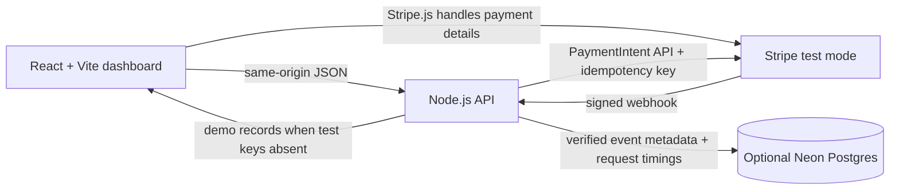

# PulsePay — Payment Reliability Desk

**A practical workbench for understanding payment failures and webhook behavior in Stripe test mode.** Create and inspect PaymentIntents, verify signed webhook events, observe outbound Stripe API latency, and learn when a retry is safe. A recovery lab exercises synthetic failure classes with explainable recommendations.

> **Live app:** [pulsepay-payment-performance-lab.vercel.app](https://pulsepay-payment-performance-lab.vercel.app) · **Repository:** [rithika20252024/pulsepay-payment-performance-lab](https://github.com/rithika20252024/pulsepay-payment-performance-lab)

The hosted app runs in demo mode until test credentials are configured. Example records are labelled sample data. No real payments are processed. This is an integration and learning tool, not a payment processor, production monitoring system, or load-testing tool.

## Why this exists

Payment recovery is easy to get wrong: a timed-out request may have succeeded at the provider, while blindly retrying can create duplicate work. Card declines, authentication requirements, validation errors, and rate limits need different responses. Payment systems also rely on webhook delivery, where events may be retried or arrive out of order.

PulsePay makes these concerns inspectable in one small application. It applies Stripe’s idempotency and PaymentIntent patterns and keeps the recovery decision visible to the developer rather than hiding it behind an automatic retry loop.

## Capabilities

| Capability | What it does | Data source |
| --- | --- | --- |
| PaymentIntent desk | Lists recent test intents and creates a new intent with a stable idempotency key | Stripe API when test keys are configured; otherwise labelled examples |
| Recovery decision lab | Maps network ambiguity, 429s, declines, authentication, invalid input, and in-progress states to safe next steps | Application policy table; synthetic latency distributions are explicitly marked |
| Webhook inbox | Verifies timestamped Stripe signatures, rejects live-mode events, deduplicates event IDs, and guards payment state updates against older events | Real signed test events; sample feed when storage has no events |
| API latency | Reports p50/p95/p99 from observed outbound Stripe API calls, with request count and measurement window | Neon Postgres if configured; otherwise the current server process |
| Export | Downloads the measured latency summary as CSV | Same source and window displayed in the UI |

## Architecture



React and Vite power the dashboard. The Node API handles Stripe secrets and webhook verification. Card details are entered into Stripe Elements and sent directly from the browser to Stripe.js; they are never posted to the application server. Optional Neon storage persists event IDs, payment state, and request timing metadata. Without it, state is process-local and resets when the server restarts.

## Recovery behavior

| Failure class | Recommended response |
| --- | --- |
| Network timeout or connection error | Reconcile the PaymentIntent or event state first; if retrying the same operation, reuse the same idempotency key and parameters |
| Rate limit | Honor `Retry-After` when present, use bounded exponential backoff with jitter, and retain the idempotency key |
| Card decline | Do not retry automatically; ask for another payment method or customer action |
| Authentication required | Resume the customer authentication step; do not create a second intent |
| Invalid request | Correct parameters or configuration before another request |
| Already processing | Wait for state or webhook update instead of creating another intent |

These are educational recommendations, not a universal retry policy. Stripe idempotency protects repeated requests using the same key and parameters; it does not make arbitrary new requests safe.

## Run locally

Requires Node.js 20 or newer.

```bash
npm install
cp .env.example .env.local
```

The app reads process environment variables; `.env.local` is an example file and is not automatically loaded by Node. Export values in your shell or use a local environment loader of your choice. Start both the API and Vite frontend:

```bash
export STRIPE_SECRET_KEY=sk_test_...
export STRIPE_PUBLISHABLE_KEY=pk_test_...
npm run dev
```

Open [http://localhost:5173](http://localhost:5173). Without Stripe test keys, the app runs in demo mode and the create-intent action stays disabled. Build and serve the production bundle locally with:

```bash
npm run build
npm start
```

## Stripe test mode and webhooks

1. Create **test-mode** API keys in your Stripe dashboard. Set `STRIPE_SECRET_KEY=sk_test_...` and `STRIPE_PUBLISHABLE_KEY=pk_test_...` in the local or Vercel environment. Never expose the secret key in browser code or commit it.
2. Create a PaymentIntent from the dashboard. The server sends a unique `Idempotency-Key` header, records Stripe's request ID and outbound duration, and returns the client secret. Stripe Elements collects test payment details in the browser and Stripe.js confirms the intent; the dashboard then refreshes the PaymentIntent list. Intent creation alone is not reported as a successful payment.
3. Forward local events using the Stripe CLI and set the printed signing secret:

   ```bash
   stripe listen --forward-to localhost:3000/api/webhooks/stripe
   ```

4. Configure `STRIPE_WEBHOOK_SECRET=whsec_...`. The endpoint checks the raw request body against Stripe's timestamped HMAC signature with a five-minute tolerance, rejects live-mode events, stores event IDs idempotently, and only applies a payment state if the incoming event timestamp is not older than the stored one.

## Optional durable storage

Set `DATABASE_URL` to a Neon Postgres connection string and run [`db/schema.sql`](db/schema.sql) once. The schema stores payment metadata, event IDs, Stripe request IDs, and timings. It intentionally excludes raw event bodies, card data, and customer details. Without a database, the app uses bounded in-process buffers, which are not shared across Vercel function instances.

## Deploy on Vercel

The repository includes a Vercel serverless handler at [`api/[...path].js`](api/[...path].js), and `vercel.json` builds the React frontend into `dist` while routing `/api/*` to the Node function.

1. Import this repository into Vercel (or connect the existing `pulsepay-payment-performance-lab` project).
2. Set the build command to `npm run build` and output directory to `dist` (already represented in `vercel.json`).
3. Add `STRIPE_SECRET_KEY`, `STRIPE_PUBLISHABLE_KEY`, and `STRIPE_WEBHOOK_SECRET` under Vercel project environment variables using test-mode credentials. Add `DATABASE_URL` if persistent inbox/metrics are desired.
4. Redeploy after setting variables. Configure the Stripe test-mode webhook endpoint to `https://pulsepay-payment-performance-lab.vercel.app/api/webhooks/stripe` and subscribe to PaymentIntent events.

The app remains usable in labelled demo mode without Stripe configuration. Vercel function memory is ephemeral; use Postgres for durable event deduplication and aggregated latency.

## API reference

| Method and route | Purpose |
| --- | --- |
| `GET /api/config` | Reports demo/test mode, webhook readiness, and storage status; exposes only the test publishable key |
| `GET /api/health` | Health and runtime mode |
| `GET /api/payments` | Recent Stripe test PaymentIntents or explicitly labelled demo records |
| `POST /api/payment-intents` | Creates an intent; requires amount in minor units, currency, and `Idempotency-Key` |
| `GET /api/payment-intents/:id` | Retrieves an intent and measures the outbound Stripe request |
| `GET /api/events` | Lists verified webhook inbox events or demo examples |
| `POST /api/webhooks/stripe` | Verifies raw-body signature, rejects live mode, deduplicates event ID, and updates state safely |
| `GET /api/metrics` | Observed Stripe API latency percentiles and sample count |
| `POST /api/recovery/evaluate` | Returns a recovery recommendation for a failure scenario |
| `POST /api/recovery/simulate` | Generates clearly synthetic scenario timings and percentiles |

## Measurement notes

The latency series measures elapsed time around the outbound `fetch` to Stripe and is recorded by the API process. With Neon configured, the UI reports a rolling 24-hour query; without it, it reports the current process lifetime. The measurement excludes browser rendering, customer interaction, and the full payment lifecycle. Synthetic recovery distributions are separate from measured Stripe calls. Empty measurements are displayed as empty rather than invented numbers.

## Repository structure

```text
api/[...path].js   Vercel Node API, Stripe calls, webhook verification, recovery policy
db/schema.sql      Optional Neon Postgres schema
src/App.jsx        React payment reliability dashboard
src/main.jsx       Frontend entry point
src/styles.css     Responsive application styling
server.js          Local Node API and static frontend server
vite.config.js     Vite build and local API proxy
vercel.json        Vercel build and function configuration
```

## Engineering concepts demonstrated

- API-backed React state and accessible, responsive operations UI
- Stripe PaymentIntent creation and request idempotency
- Failure classification and conservative recovery decisions
- Raw-body HMAC webhook signature verification and replay-age validation
- Event deduplication and out-of-order event protection
- Outbound provider latency measurement and percentile reporting
- Optional serverless Postgres persistence with a constrained metadata schema

## References

- [Stripe idempotent requests](https://docs.stripe.com/api/idempotent_requests)
- [Stripe PaymentIntents API](https://docs.stripe.com/api/payment_intents)
- [Stripe API errors and rate limits](https://docs.stripe.com/api/errors)
- [Stripe webhooks: signatures and delivery](https://docs.stripe.com/webhooks)
- [Stripe Payment Element](https://docs.stripe.com/payments/payment-element)
- [Neon serverless driver](https://neon.com/docs/serverless/serverless-driver)

## Scope and safety

PulsePay is an educational test-mode integration. It does not handle live payments, store cardholder data, guarantee delivery, provide production SLAs, or claim performance improvements. Add authentication, access controls, observability, retention policy, operational review, and production-grade incident handling before adapting any pattern for a real payment service.
